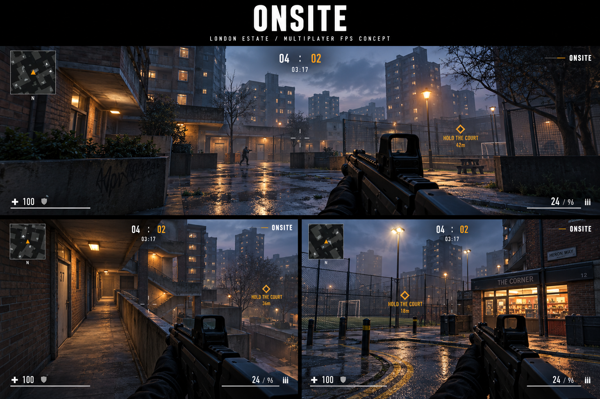

# ONSITE

A Three.js first-person shooter concept set on a fictional London estate.

[View the full-size concept image](docs/concepts/onsite-london-fps.png).

Visual direction: wet concrete, brick tower blocks, blue-hour skies, and warm street lighting. The ONSITE name, minimap, score, health, ammo, and amber objective markers stay consistent across all three views.

This is concept art for the proposed game, not a screenshot of a playable build.

## More gameplay concepts

[View all 10 additional ONSITE screens](docs/concepts/GALLERY.md) — estate entrance, stairwell, rooftop, railway underpass, corner shop, covered car park, canal path, launderette, elevated walkway, and football court.

## Character kit, intro and menu flow

[View the 15-screen front-end concept gallery](docs/concepts/FRONT-END-GALLERY.md): selectable trainers and outfits, intro stills, three title directions, character and borough selection, match setup, squad lobby, loading, pause/settings, and results.
