# ONSITE — Black characters and modelling references

Three new UI screens featuring Black British characters Jay and Alex, plus eight individual modelling reference sheets. These extend the established ONSITE menu layout, black streetwear and white-and-amber identity.

[Read the modelling handoff](MODELLING-NOTES.md). Reference sheets are images, not finished 3D assets.

## UI screens

### Jay Selection

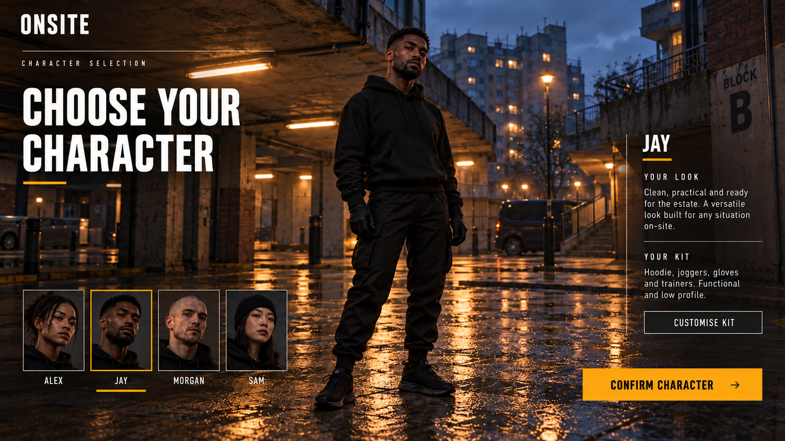

[Open full-size image](character-assets/jay-selection.png)

### Alex Selection

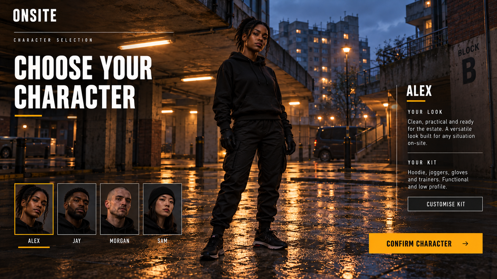

[Open full-size image](character-assets/alex-selection.png)

### Jay Head Kit

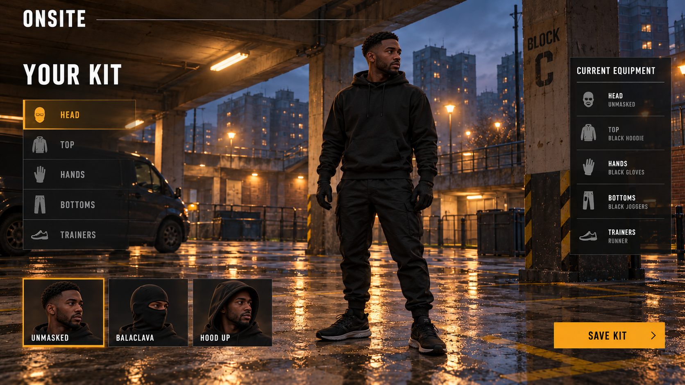

[Open full-size image](character-assets/jay-head-kit.png)

## Individual modelling references

The separate garment and trainer sheets define the kit construction. The corrected character sheets below match those references.

### Jay

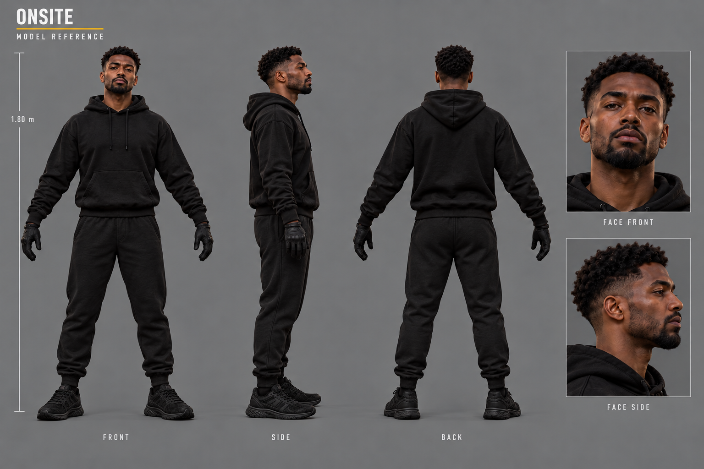

[Open full-size image](character-assets/asset-jay.png)

### Alex

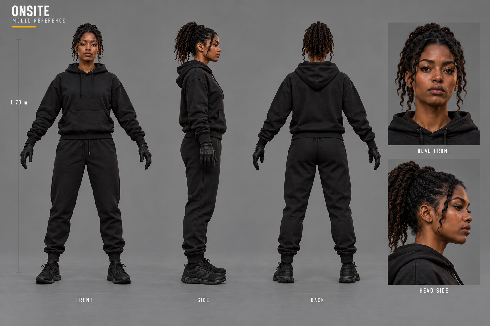

[Open full-size image](character-assets/asset-alex.png)

### Runner

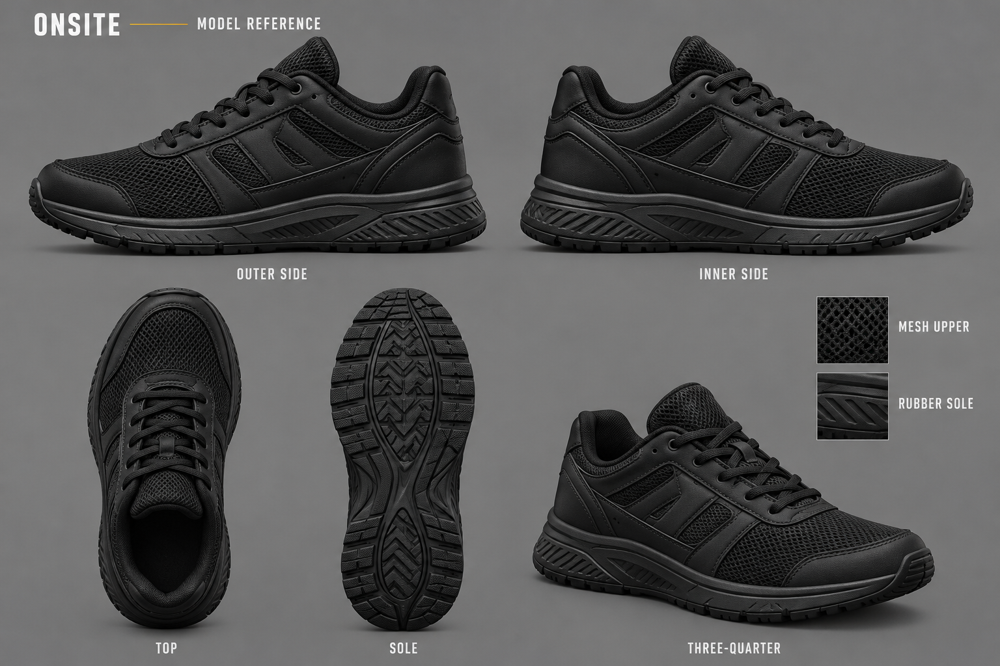

[Open full-size image](character-assets/asset-runner.png)

### Hoodie

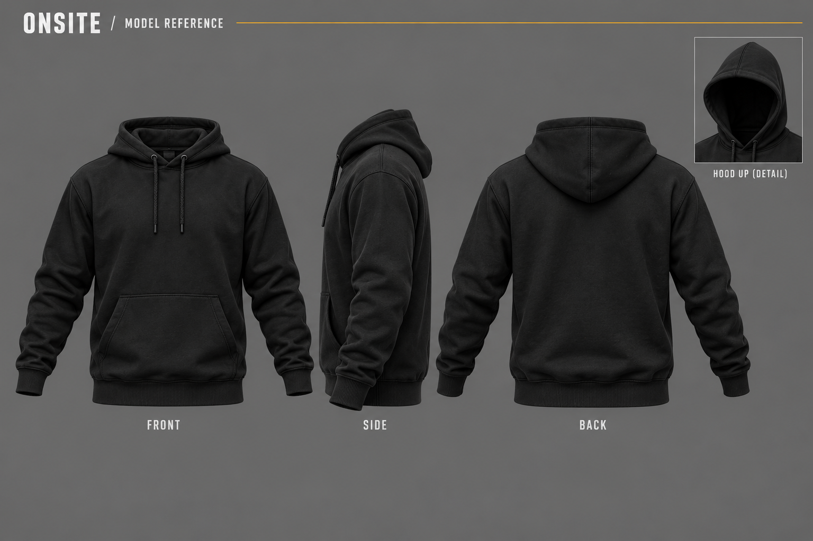

[Open full-size image](character-assets/asset-hoodie.png)

### Joggers

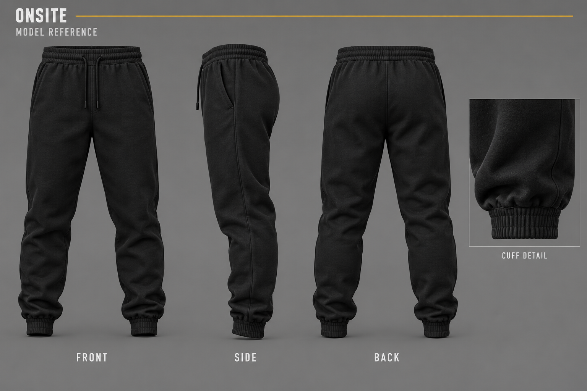

[Open full-size image](character-assets/asset-joggers.png)

### Balaclava

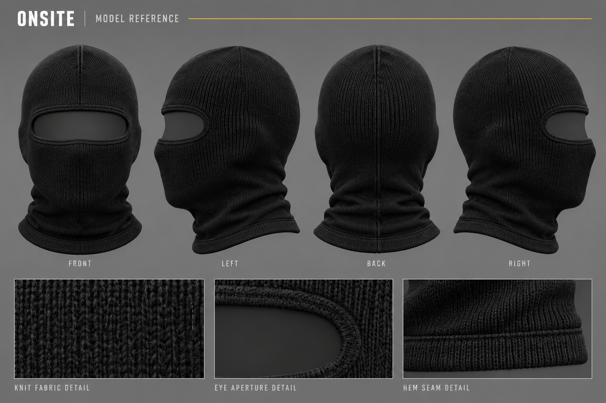

[Open full-size image](character-assets/asset-balaclava.png)

### Facade

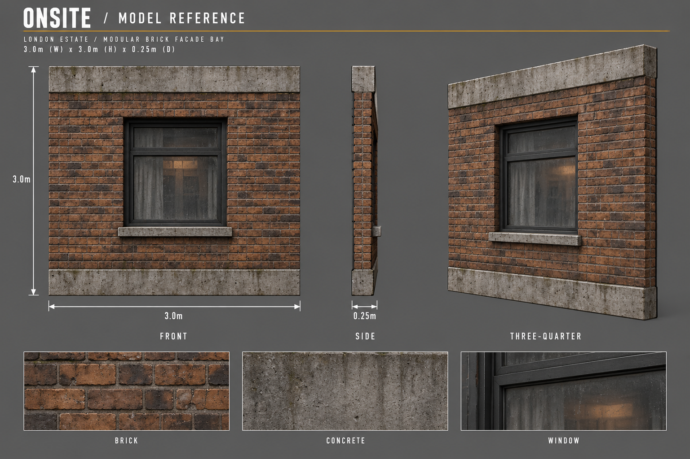

[Open full-size image](character-assets/asset-facade.png)

### Fence

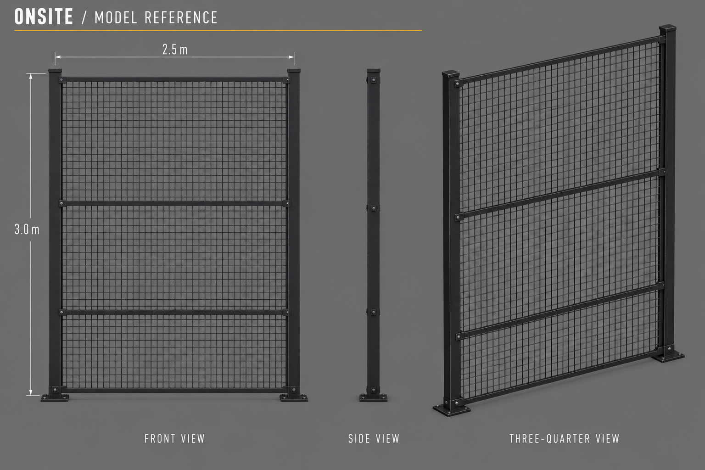

[Open full-size image](character-assets/asset-fence.png)

