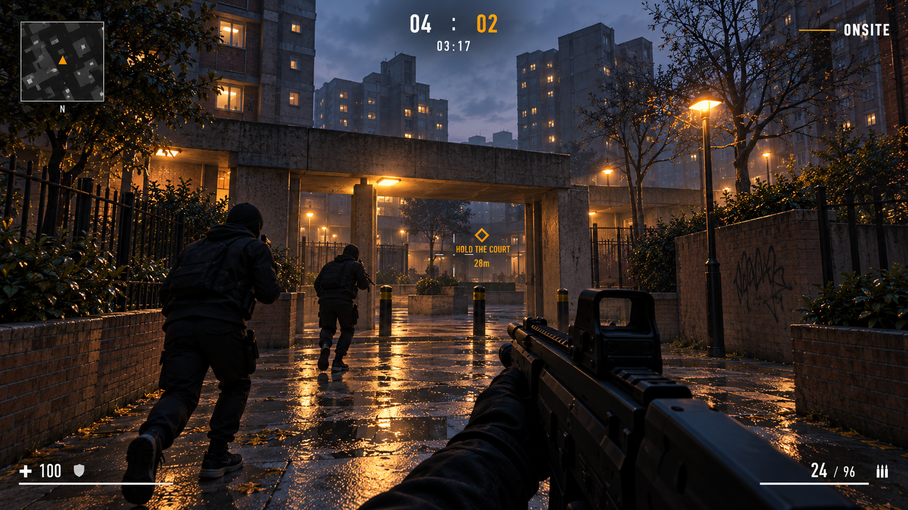
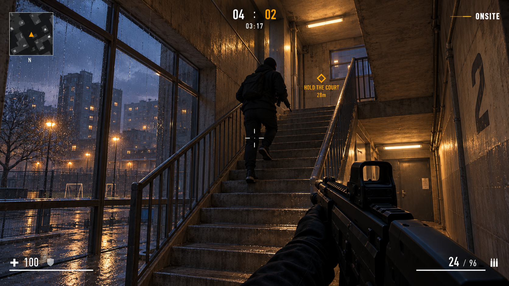
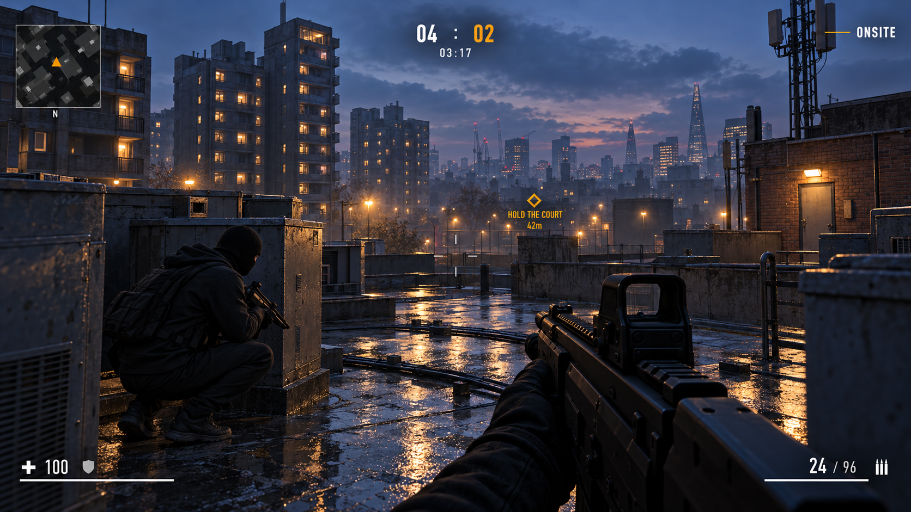
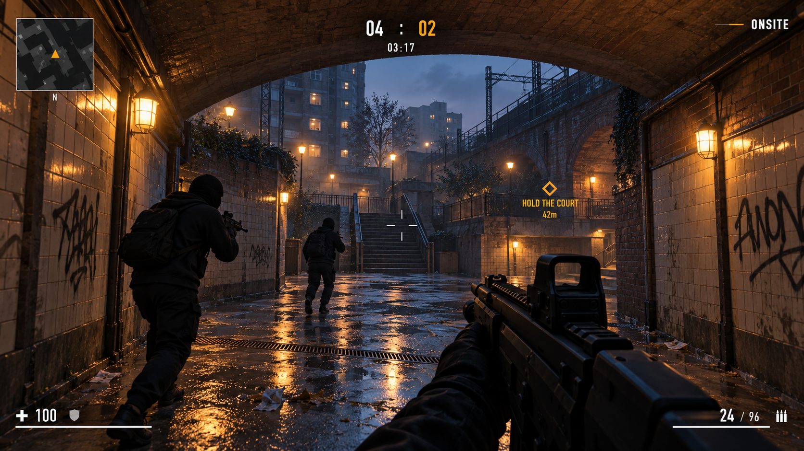
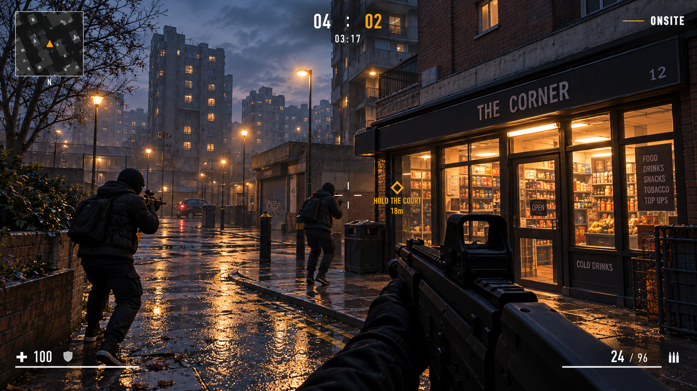
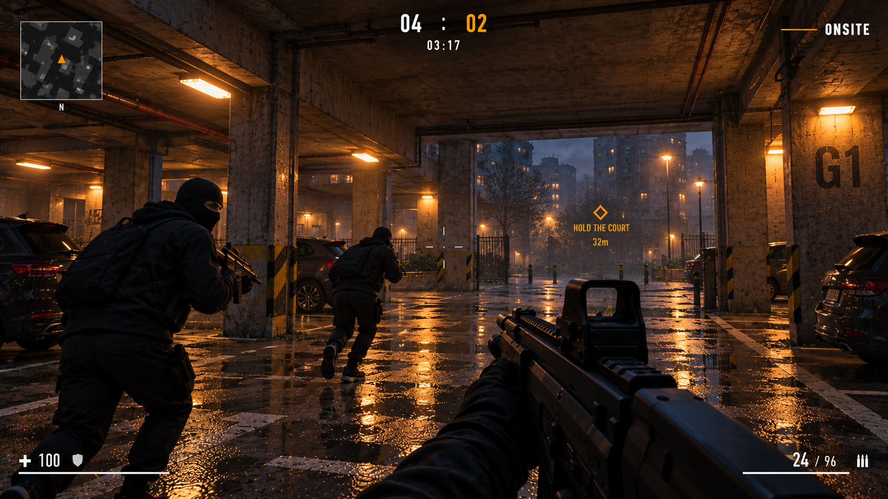
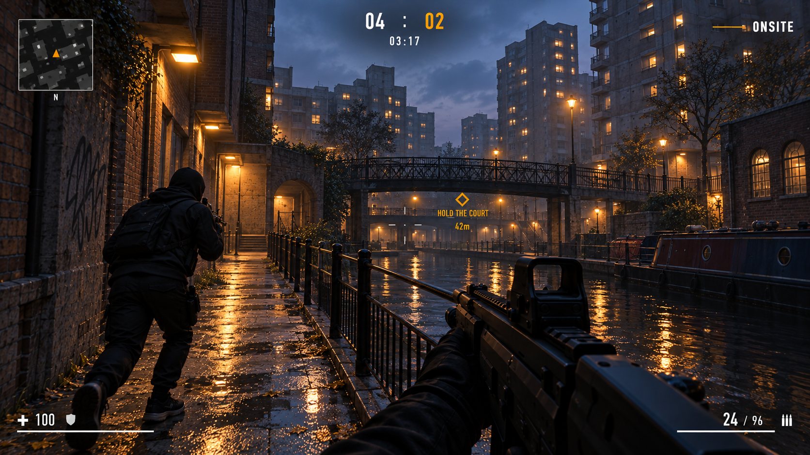
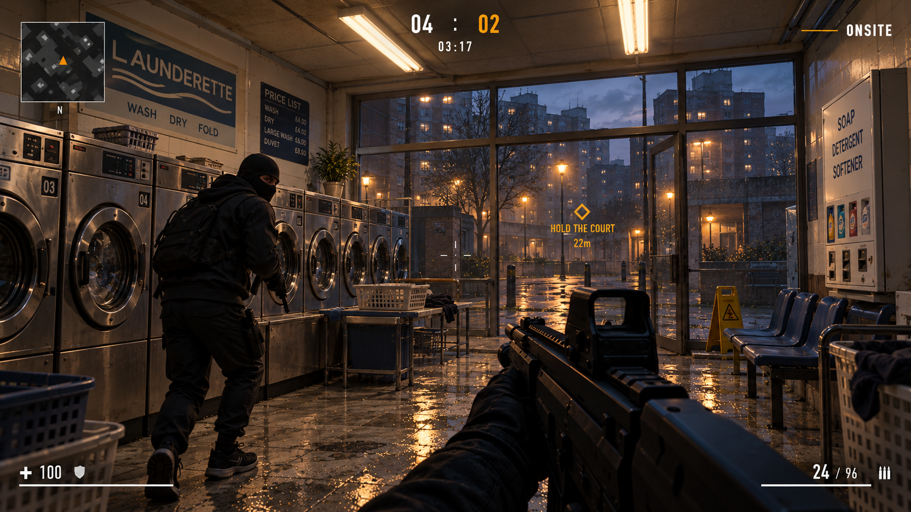
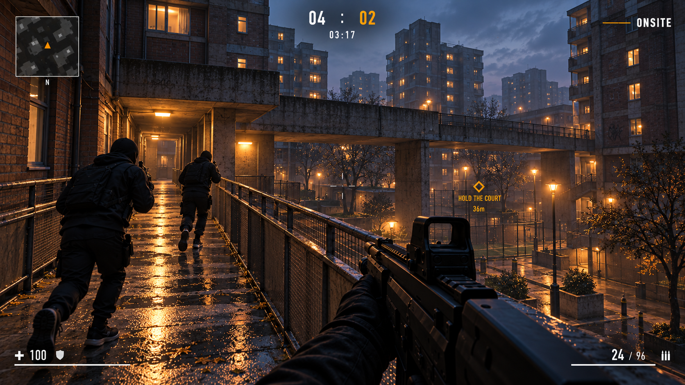
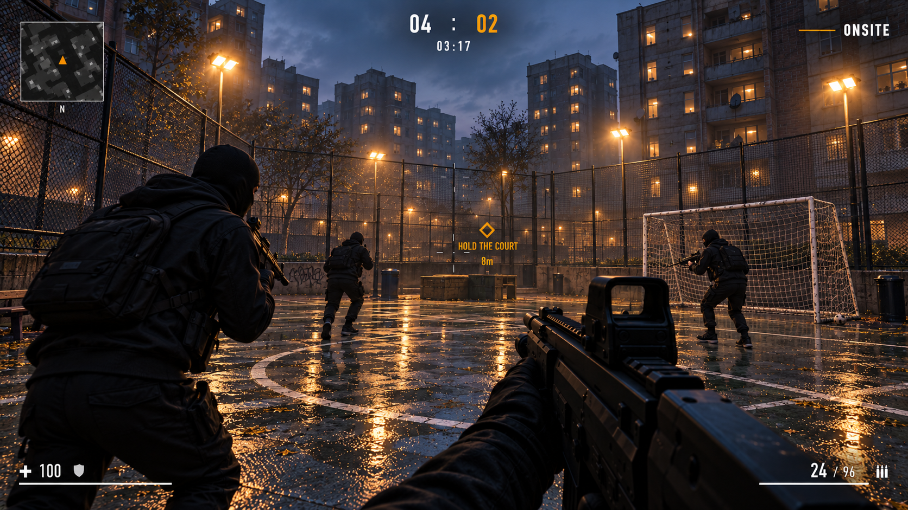

# ONSITE — London estate screen gallery

Ten additional gameplay concepts using the established white-and-amber HUD and ONSITE identity. Characters wear black streetwear: hoodies, balaclavas, gloves, and jogging bottoms.

These are generated concept images, not captures of a playable build.

## 01 — Estate entrance

[Open full-size image](screens/01-estate-entrance.png)

## 02 — Stairwell

[Open full-size image](screens/02-stairwell.png)

## 03 — Rooftop

[Open full-size image](screens/03-rooftop.png)

## 04 — Railway underpass

[Open full-size image](screens/04-underpass.png)

## 05 — Corner shop

[Open full-size image](screens/05-corner-shop.png)

## 06 — Covered car park

[Open full-size image](screens/06-car-park.png)

## 07 — Canal path

[Open full-size image](screens/07-canal-path.png)

## 08 — Launderette

[Open full-size image](screens/08-launderette.png)

## 09 — Elevated walkway

[Open full-size image](screens/09-walkway-bridge.png)

## 10 — Football court

[Open full-size image](screens/10-football-court.png)

